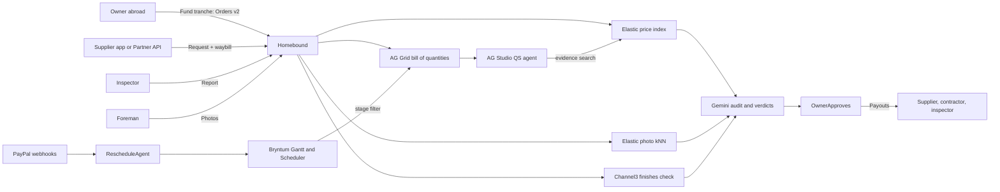

# Homebound: diaspora home-build platform (working name for now)

## Why this one
- All earlier concepts (firewall, escrow, scam guard, dispute copilot) and the ajo/group-collection space (SarafuPay) are already taken by polished entries.
- I found no PayPal-hackathon entry for diaspora-funded construction. DiasporaBuild is a real startup with a Stripe stack, which shows the problem is real.
- The mechanism overlaps with ProofPay, DeliverPay and Holdfast (AI-verified milestone payments). The edge has to come from:
  - **Physical-world evidence.** Photos, waybills and inspections.
  - **Multiple payees, paid directly.** Supplier, contractor and inspector, not "send it to my uncle".
  - **Platform-wide intelligence.** Price benchmarks and reused-photo detection across every project, which a single-project tool can't do.
- Prizes:
  - Sponsor prizes with a category: Bryntum, AG Grid, APIMatic, Channel3, Render. A project can win at most one sponsor prize plus one grand or honorable-mention prize.
  - Elastic and Postman have no prize category. They are here purely because they make the product better.
  - Honorable mentions to aim for: Most Impactful, Best Demo Delivery, Best Use of PayPal + AI.

## Roles
- **Owner (abroad):** funds stages, approves payouts, chooses finishes.
- **Contractor and foreman:** plan, site photos, labor claims.
- **Material supplier:** material requests and waybills (through the app or the partner API).
- **Independent inspector:** scheduled site visits; paid per report.

## Sponsor tech: each one has a real job
- **Bryntum Gantt: when, and what is blocked.** Stages with payment tranches as dependencies; an unverified stage blocks the next one; the rescheduler moves dependent tasks.
- **Bryntum Scheduler: who inspects which site, when.** Inspectors are rows and visits are events; a submitted report releases that visit's payout.
- **AG Grid: where the money went.** A bill-of-quantities grid with one row per line item. Columns:
  - quoted quantity and price,
  - market median (from Elastic),
  - supplier-requested quantity and price,
  - amount paid (PayPal payout ID),
  - quantity delivered (from the waybill),
  - variance flags.

  Selecting a stage on the Gantt filters the grid to that stage.
- **AG Studio with a custom agent: a quantity-surveyor assistant.** It answers "what did my money buy?" and "where is the overrun?", citing ledger rows and evidence. It can draft an update to the family but can never move money.
- **Elastic: the platform's memory.**
  - **Price index.** Every quote, supplier request, payout and waybill line from every project becomes a price observation. Embeddings normalize messy item names ("Dangote 42.5R 50kg" and "dangote cement bag" become the same item). ES|QL gives the median per item, city and month, which feeds the supplier audit and the grid's market column.
  - **Reused-photo detection.** Every site photo is stored as an image embedding. A kNN search across *all* projects catches a photo reused from another client's site or taken from the web; a per-project hash check can't.
  - **Evidence search.** Hybrid search over messages, voice-note transcripts, waybills and inspection reports. This is the agent's retrieval tool.
- **Channel3: the finishes stage (about 20% of the budget).** Its US, UK, Canadian and European coverage matches where the owner lives.
  - **Price reference.** A contractor quotes an "imported Italian WC, ₦850k". Channel3 returns UK or US retail prices, and the AI adds shipping and duty to give a fair-price range.
  - **Buy abroad or pay locally.** The owner either buys from the retailer's buy link and ships it home (logged in the ledger), or pays the local supplier through PayPal.
  - **Substitution check.** Channel3 image search on the photo of the installed fixture is compared with the product that was specified and paid for.
- **Postman: the partner API lifecycle.** Suppliers and inspectors integrate through a public partner API. It is:
  - designed in Postman from the OpenAPI spec, with a public workspace, docs and examples,
  - backed by a mock server so partners can build before going live,
  - covered by collection tests that the Postman CLI runs in GitHub Actions against the Render deployment,
  - watched by a scheduled monitor that runs the money-path smoke test.
- **APIMatic:** its generated `@paypal/paypal-server-sdk` is the payments client; its Context Plugin audits the money code. Findings go in `docs/APIMATIC.md`.
- **Render:** web service, Postgres, and a cron job that re-checks pending Orders and Payouts when a webhook is lost.
- **Not used (no real job):** Kernel, Zapier, Astropods.

## Core flow

## Stack (TypeScript, one repo)
- Next.js on Render, with Drizzle and Postgres (PGlite locally).
- Bryntum Gantt and Scheduler trials via npm (`@bryntum/gantt@npm:@bryntum/gantt-trial`, and the same pattern for the Scheduler).
- AG Grid (React) and AG Studio with its agent framework.
- PayPal: the APIMatic-generated `@paypal/paypal-server-sdk` for Orders v2, the Payouts REST API, and webhook signature verification.
- Gemini through the Vercel AI SDK with structured outputs, for:
  - photo verdicts,
  - waybill OCR,
  - supplier audit,
  - finishes fair-price ranges.
- Elastic Serverless (trial plus the 30-day extension) with Jina embeddings. A `start-local` Docker option lets judges run it themselves.
- Channel3 through `@channel3/sdk`.
- Postman: OpenAPI spec, collection, mock server, Postman CLI in GitHub Actions, monitor.
- Safety:
  - The AI only recommends; the owner approves every payout.
  - Use idempotency keys and an append-only money ledger.
  - The app still works if Elastic or Channel3 is down; the related checks show as "unavailable".
- Never commit keys: keep them in `.env.local` and Render environment variables.

## Honest framing for judges
- Everything runs in the sandbox with US sandbox accounts labeled as Nigerian payees.
- Nigerian PayPal accounts are limited for receiving money. The README names a production path (Xoom bank deposit or Hyperwallet).
- Holding funds would need a licensed escrow partner.
- The seeded price data and the other projects are synthetic and labeled as such. Where public Nigerian material-price lists are used, cite them.

## Schedule (Nov 3 to Nov 12)
- **Nov 3:** Setup and all sponsor accounts. Spikes for: Gantt, AG Grid, one Order plus one Payout, an Elastic index with an embedding, a Channel3 search.
- **Nov 4:**
  - Data model; seed the synthetic platform (projects, price observations) into Postgres and Elastic.
  - Gantt and grid linked by stage.
  - Orders funding with a verified webhook.
- **Nov 5:**
  - Photo, Gemini verdict, owner-approved labor Payout.
  - Deploy to Render.
  - **Devpost draft for the early eligibility review.**
- **Nov 6:** Supplier direct-pay with the Elastic price-index audit; waybill OCR; partner API endpoints specified in Postman.
- **Nov 7:** Reused-photo detection across projects; EXIF and geofence checks; webhook rescheduler; Render cron.
- **Nov 8:** Channel3 finishes stage (price reference, buy abroad or pay locally, substitution check). Inspector Scheduler with per-visit payouts.
- **Nov 9:** AG Studio QS agent with Elastic evidence search. Postman tests in CI, monitor, public workspace.
- **Nov 10:** Hardening, `/paypal:doctor`, README with a section per sponsor; record the video.
- **Nov 11:** Final submission. **Nov 12:** Buffer only.

## Cut order if time runs short
1. Postman monitor (keep the spec, collection and CI tests).
2. Inspector Scheduler (inspection reports stay as evidence without scheduling).
3. Waybill OCR (the delivered column becomes manual).

Never cut: the core money loop, the Gantt, the grid, the Elastic price index and photo kNN, the Channel3 finishes check, or the QS agent.

## Housekeeping
- Mark the older brief `paypal_ai_hackathon_concepts_7c8d77cf.plan.md` as superseded.
